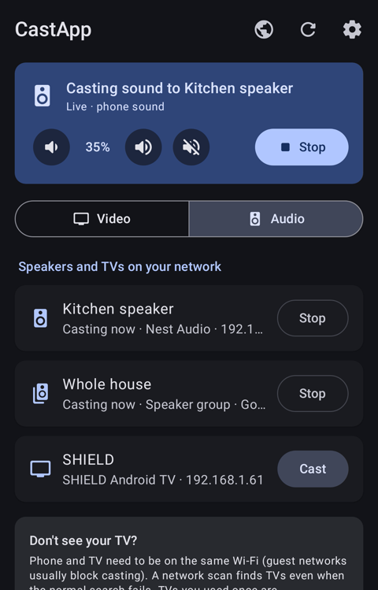
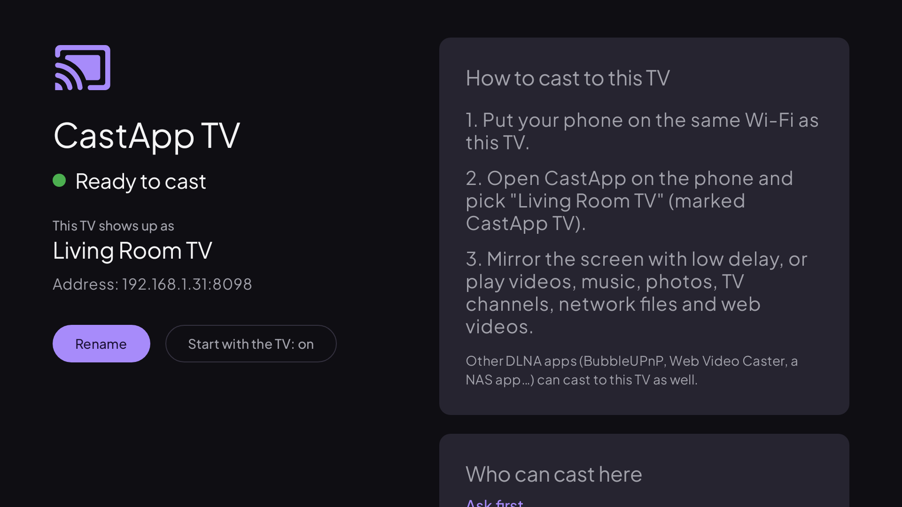

# CastApp

Android app that casts to a **Chromecast**, **NVIDIA Shield**, **Google TV**, **Google/Nest speakers**, **DLNA smart TVs** (Samsung, LG, Sony…), **Fire TV** and other Android TV boxes (with the included TV app), **Kodi**, **Apple TV** (AirPlay) and **Roku** (experimental). It can:

- mirror your screen or a single app, in a quality you can change at any moment
- play the phone's sound
- play videos, music and photos from the phone, a NAS, a PC's shared folder, a media server or a cloud folder, with **Plex** and **Jellyfin/Emby** built in (sign-in, posters, resume synced with the server)
- play TV channels and radio from IPTV / M3U channel lists, with a guide grid, reminders, **recordings** and a parental lock
- cast to **several screens at once**, and let other phones with CastApp **join** your cast or **take it over**
- play videos it finds on websites
- write subtitles for videos that have none, on the phone and offline, or find them online
- work as a **TV remote** (network, Bluetooth or infrared) and **receive** a cast on the phone itself
- show a **programme guide** for IPTV channels, with catch-up where the provider offers it
- resume videos where you stopped, edit the queue, set a sleep timer, pick audio and subtitle tracks
- send **YouTube links** to the YouTube app on the TV

No ads, no tracking, no account. It doesn't need Google Play Services (only the optional Wear OS remote does) or the phone's built-in Cast menu; it talks to your devices directly over your Wi-Fi. TVs and speakers don't need CastApp installed; a TV with CastApp TV gets extras such as lower delay, swap direction and synced playback.

<p>
  
  
  
</p>
<p>
  
  
</p>

## Which devices work

| Device | How | Screen mirroring | Files, network, TV channels, web videos |
|---|---|---|---|
| Chromecast (all), Google TV Streamer | Google Cast | ✅ under 1 s delay | ✅ |
| NVIDIA Shield, Sony/Philips/TCL/Hisense TVs with Google TV or Android TV | Google Cast (built in) | ✅ | ✅ |
| Google Nest and other Cast speakers | Google Cast | sound only | music, radio |
| **Fire TV**, Android TV boxes, projectors with Android | **CastApp TV** (this app, installed on the TV, see below) | ✅ low delay (aims for under half a second) | ✅ including subtitles |
| Samsung, LG, Sony, Panasonic, Philips smart TVs | DLNA | ⚠️ experimental, a few seconds of delay | ✅ mostly (depends on the TV's formats) |
| Kodi (on any box or PC) | DLNA (turn on UPnP in Kodi) | ⚠️ experimental | ✅ |
| **Apple TV**, Macs and TVs with AirPlay | AirPlay (code on the TV the first time) | ⚠️ experimental, a few seconds of delay | ✅ videos, music, web videos, HLS channels; no subtitles or photos |
| **Roku** players and Roku TVs | Roku's "Play on Roku" (experimental) | ⚠️ experimental | ✅ but no seeking; converted files play as HLS |
| **Another phone or tablet** with CastApp | CastApp receiver ("Receive on this phone") | ✅ | ✅ |

Many TVs answer in several ways (for example a Sony TV with Chromecast, DLNA and AirPlay). CastApp lists each TV once, the best way first: Google Cast, then DLNA, Roku, AirPlay. A CastApp TV receiver is always listed, even on a Shield or Google TV, because its mirroring is faster.

The **TV remote** works with a different list of devices, see [TV remote](#tv-remote).

Not supported: the newest Fire TV sticks with Vega OS (they can't install Android apps), and AirPlay speakers such as HomePods (they need a different audio protocol).

## Why it finds devices the built-in Cast menu misses

The system Cast menu relies on a single discovery method (multicast DNS). That method often breaks with mesh Wi-Fi, some routers, or a phone that is aggressively saving power. CastApp combines five methods:

1. **Android's own discovery** (NsdManager)
2. **Its own mDNS browser.** Devices answer it directly by unicast, so this works even when multicast replies get dropped. It also finds Apple TVs and other AirPlay receivers.
3. **DLNA/UPnP search (SSDP).** This finds smart TVs without Chromecast, CastApp TV receivers, Kodi and Rokus.
4. **Network scan.** It checks every address on your Wi-Fi for a Cast device and asks each one for its name. If nothing turns up within 4 seconds, the scan starts automatically.
5. **Add by IP.** You type the address yourself.

Any device you've cast to once is **remembered**. If its IP address changes, CastApp finds it again.

## Features

**Video mode** (TVs):

- **Mirror the entire screen** with one tap on **Cast**.
- **Cast a single app.**
  - Android 14 and newer: Android's own picker; only that app is shown on the TV.
  - Android 13 and older: the screen is mirrored and the app you pick opens.
- **Videos, music and photos from the phone**, with the phone's screen off.
  - Pick several files to get a **play list**.
  - **Photos** become a slideshow, shrunk to TV size; HEIC and huge photos work too.
  - **Subtitles**: pick an `.srt`/`.vtt`/`.ass` file named after the video (or pick just one video and its subtitle files). With one file per language (`Video.English.srt`, `Video.German.srt`…), the one in your subtitle language is shown and the others can be picked. They can be switched on and off.
  - Also available from any gallery or file app via **Share → Cast to TV**.
- **TV channels (IPTV)**, **network shares, NAS, media servers and cloud folders**: see the sections below.
- **Change the picture quality at any moment** with the **Quality** button on the casting card (see below).
- **Subtitles written by the phone** for videos and music that have none (see below).
- **Videos from websites**: the built-in browser (🌐 at the top) spots the videos a page plays and sends them to the TV. The TV then plays them by itself, so you can leave the app or lock the phone. A link shared from Firefox, Chrome and so on (**Share → Cast to TV**) opens in this browser.
- **Converts videos the TV can't play** (e.g. HEVC or MKV on an older Chromecast). The phone re-encodes them to H.264/AAC on the fly. This happens automatically; you can choose Automatic, Always or Never in Settings.
- **HEVC** (optional): in Settings choose Automatic, H.264 or HEVC. HEVC gives a sharper picture at the same bitrate. *Automatic* only uses it where it is known to work: CastApp TVs that report it, Chromecast Ultra and HD, Google TV Streamer and NVIDIA Shield. If a device can't play it, CastApp falls back to H.264 by itself.
- **Phone microphone** (optional): mix your voice into the sound, for presentations or karaoke. Beware of echo: use headphones, or the TV's sound comes back through the microphone.
- **YouTube links**: share a YouTube link to CastApp, or use **YouTube on TV** in the browser. On a Chromecast or Google TV the video plays in the YouTube app (CastApp uses YouTube's unofficial "lounge" protocol). On a CastApp TV it opens the TV's YouTube app.
- **Do Not Disturb** can be switched on automatically while you mirror, so no notification shows up on the TV.
- **Dark screen** (Android 14+, single-app casting): the phone goes black at minimum brightness while the app keeps playing on the TV. Tap once for controls, double-tap to wake.

**Playback** (files, network, channels):

- **Continue watching**: videos resume where you stopped. A history row on the main screen lists them.
- **Queue editing**: reorder, remove, add, shuffle and repeat.
- **Sleep timer**, also "end of video".
- **Audio track choice**. Tracks the TV can't play are converted on the phone.
- **Built-in subtitle tracks** of a file (text ones; picture subtitles such as PGS and VobSub are not supported).
- **One subtitle picker**: Off, the file's own, built-in, written by the phone, or found online.
- **Subtitle look** (size, colour, background) on Google Cast and CastApp TV, and **timing** in steps of 0.5 s.
- **Subtitles written ahead** for the next files in the queue.
- Apple TV and Roku get converted files as HLS.

**Audio mode** (switch at the top):

- Lists **speakers and speaker groups** as well as TVs.
- **Cast the phone's sound** (Android 10+): whatever plays on the phone plays on the speaker. The microphone is never used.
- **Play music files** on a speaker.

**Picture and sound:**

- **Low delay**, under a second with Google's standard player.
- An optional own **low-latency TV player** gets it to about 0.3 s (see below).
- **Automatic quality**: when the Wi-Fi can't keep up, the bitrate drops; when the connection is good again, it rises.
- **Picture shape**:
  - *Fit*: black bars where the shapes differ.
  - *Fill the TV*: zooms in and cuts off the edges.
  - *Turn apps sideways*: rotates the phone's apps to landscape so they fill the TV.
- **Sound sync**: shift the sound ±500 ms. Changes apply instantly while casting.
- **Reconnects by itself** if the Wi-Fi drops or the TV restarts. It keeps trying for 2 minutes, and a file continues where it stopped.

**Controls and quick access:**

- TV volume and mute from the app, the notification and, when casting a file, the phone's volume buttons.
- Media controls on the lock screen when casting files.
- **Quick Settings tiles**: "Cast screen" (tap to mirror to the last TV, tap again to stop; long-press opens the app), "Receive on this phone" and "TV remote".
- **Home-screen widget** for quick casting and stopping.
- **TV remote** from the top of the main screen and, in small, inside the casting card; see below.
- **Launcher shortcuts**: long-press the app icon for "Mirror screen to *your TV*".

**Looks:** CastApp's own violet look in a light and a dark mode that follow the system. You can force Light or Dark in Settings. On **tablets and in landscape** (600 dp and wider) the screens use two panes. The app is in **English and German** and follows the phone's language.

## Install

**Download a ready-made APK:** open the repository's **Actions** tab, select the latest **Build APK** run and download the **CastApp** artifact. It's a zip containing `CastApp.apk`. If you push a tag such as `v4.0.0`, the APK is also attached to a GitHub Release.

The APK is about 13 MB, most of it the offline speech recognition. The same APK runs on phones (Android 7.1 and newer) and on TVs. To install, open the APK on your phone and allow "Install unknown apps" for your browser or file manager when Android asks.

**Build it yourself:**

```bash
./gradlew assembleRelease
# -> app/build/outputs/apk/release/app-release.apk
```

You need JDK 17+, the Android SDK with platform `android-37.1`, the Android **NDK 29.0.14206865** and **CMake 3.22.1** (both for the Whisper speech engine). Installing them from Android Studio's SDK Manager sets that up. The CI workflow installs them by itself.

## How to use

1. Connect your phone and the TV or speaker to the **same Wi-Fi**. Guest networks usually block device-to-device traffic.
2. Open CastApp. **Cast to** at the top shows the TV everything goes to: the one you used last, or the first one found. Tap it to pick another TV, to switch between **Video** (TVs) and **Audio** (speakers and speaker groups too), to search again, scan the network or add a TV by its IP address. The ⋮ next to a TV has everything for that one TV (also its remote, forgetting it and waking it up).
3. Choose what to send:
   - **Mirror screen**, **One app** or **Phone sound** send what this phone shows or plays. For a speaker, the buttons are **Phone sound** and **Music files**.
   - The tiles below play something else: **Phone videos**, **Photos** and **Music** from this phone, **Plex**, **Jellyfin** (and Emby), **Network & cloud**, **TV channels** and **Web videos**. Files from the phone go to the TV in **Cast to**; in the other tiles you pick the TV when you start something. While a file or channel is already playing, anything new goes straight to that TV.

   While something is cast, a bar at the bottom shows what and where, with pause. Tap it to open the **casting card**: all playback controls, quality, subtitles, the queue, more screens, volume, Stop, Dark screen and a small remote. On tablets and in landscape the casting card and the TV list stand beside the tiles.
4. Confirm Android's "Start casting?" dialog. File and web-video casting doesn't need this dialog.
5. Stop from the app, the notification, the Quick Settings tile, or the TV remote.

To add the tile, pull down Quick Settings, tap the pencil (edit) icon and drag **Cast screen** into your tiles.

## Casting with the phone's screen off

| What you cast | Screen off / locked? |
|---|---|
| **Files, photos, web videos** | **Yes.** The TV fetches them itself; lock the phone and pocket it. |
| **The phone's sound** (Audio mode) | **Yes**, on most phones: music apps keep playing in the background. |
| **A single app** (Android 14+) | **Use Dark screen.** The display stays technically on but black, so the app keeps playing. The TV doesn't see the dark overlay. |
| **The entire screen** | **No.** If the screen is off there is nothing to mirror, and Android pauses most apps. |

**Can I cast from Firefox and leave it playing?** Not by mirroring Firefox: as soon as you leave it or lock the phone, the video pauses. Instead, share the page from Firefox to **Cast to TV** (or open it in CastApp's browser) and cast the video it finds. The TV then plays it on its own, like YouTube's Cast button.

## TV remote

Open the remote from the remote icon at the top of the main screen, from a TV's ⋮ menu under **Cast to** or from the casting card. The casting card also has the most used keys built in (D-pad, volume, channels, Back, Home, Menu, Mute): tap **Use this phone as the remote** there; **All buttons** opens the full remote. Three kinds are built in:

| Kind | Works with | Notes |
|---|---|---|
| **Network** | Google TV, NVIDIA Shield, Android TV | Type the pairing code the TV shows (same protocol as Google's TV remote app). A mic button does **voice search**. |
| | Roku | Nothing to set up. |
| | Samsung Tizen TVs (2016 and newer) | Tap **Allow** on the TV the first time. |
| | LG webOS | Accept the request on the TV. |
| **Bluetooth** | Fire TV, Shield, Android TV boxes | The phone pairs like a remote or keyboard. Needs Android 9+, and not every phone supports it. |
| **Infrared** | Samsung, LG, Sony, Philips (RC6 and older RC5), Panasonic, Toshiba (basic) | Only on phones with an IR blaster (Xiaomi, Redmi, POCO, some Honor and Huawei). |

Pairing the Bluetooth remote:

- **Fire TV:** Settings → Controllers & Bluetooth Devices → Other Bluetooth Devices.
- **Shield / Android TV:** Settings → Remotes & Accessories → Add accessory.

Not covered: the Apple TV remote, Samsung TVs from 2014–15, and infrared for TCL, Hisense, Sharp and Vizio.

## Receive on this phone and swap direction

A phone can be a receiver too. Turn on **Settings → Connection → Receive on this phone**, or use the quick tile. Other phones then see it as a CastApp device.

While you mirror your phone to a CastApp TV, tap **Swap: TV → phone**. The TV then mirrors to your phone instead (confirm on the TV with the remote). **Swap back** returns to the first direction. This only works with Android TVs that run CastApp. Protected apps, HDMI inputs and antenna TV stay black.

**Receiver protection** (for a CastApp TV and for a phone receiver):

| Setting | Meaning | Default |
|---|---|---|
| Anyone on the network | Every device on the Wi-Fi can cast | TVs |
| Ask first | You confirm each new sender | Phones |
| Only paired phones | A phone enters a 4-digit code once | |

## Several screens, joining and handing over

**Several screens at once.** While casting, tap **Add a screen** on the casting card and pick another TV or speaker, of any kind. Each screen gets its own row with status, volume and remove; the cast ends when the last screen goes.

- *Mirroring* keeps one capture and sends each screen the format it can play (low-latency MP4 to CastApp TVs, MP4 or HLS to Google Cast, TS to DLNA TVs, HLS to Apple TV and Roku, sound to speakers). A group always uses H.264, and the automatic quality follows the slowest screen.
- *Files, network videos and channels* play on every screen; play, pause, seek and skip go to all of them.
- **Synced playback** (multi-room): CastApp TVs and phones that joined stay within about 0.1 s of each other. Other TVs are best effort, usually within about a second.

**Join a cast.** Phones, tablets and CastApp TVs with CastApp see "*Name* is casting *title*" on the main screen with **Join**: the stream then plays on that device too. The device that casts decides who may join: **Ask first** (default), **Anyone on this Wi-Fi** or **Off**, and sees how many are watching.

**Hand over.** The device that casts can tap **Hand over…** and pick a nearby phone or tablet with CastApp. That one gets "*Name* offers you *TV*. Take over?", and only a **yes** moves the cast:

- *Mirroring*: the new phone asks for its own screen-capture permission and casts to the same screens; the first phone stops once it has taken over.
- *Web videos, NAS over http, TV channels*: the new phone continues the queue at the same position.
- *Files only the first phone can read* (its own files, SMB shares): the new phone gets the controls while the first one keeps serving the file.

The other way round, a phone can tap **Ask to cast**; the casting device then sees "*Name* wants to cast. Hand over?". Everything stays on your Wi-Fi.

## CastApp TV: the receiver for Fire TV and Android TV

The same APK installed on a Fire TV (Fire OS 6 or newer), an Android TV / Google TV box or an Android projector turns it into a receiver. On a TV it opens **CastApp TV** instead of the phone screens:

<p></p>

- It shows up on the phone with a **CastApp TV** label, and plays everything: screen mirroring with low delay (it plays the phone's stream with almost no buffer and speeds up slightly when it falls behind), videos with subtitles, music, photos, TV channels, network files and web videos.
- It is a standard DLNA renderer, so other DLNA apps (BubbleUPnP, Web Video Caster, NAS apps) can cast to it too.
- **Start with the TV** keeps it ready after a restart. **Rename** sets the name phones see (by default the TV's own name).

**Installing on a Fire TV:**

1. On the Fire TV: **Settings → My Fire TV → Developer options** (on newer models: **About**, then press the select button 7 times on the device name to show Developer options) → **Install unknown apps** (on older models **Apps from Unknown Sources**) → allow the app you'll install with.
2. Get the APK onto the TV, for example:
   - With the free **Downloader** app: enter the address of `CastApp.apk`. Push a tag such as `v4.0.0` so the GitHub release holds the APK; on a public repository the address is `https://github.com/<user>/<repo>/releases/latest/download/CastApp.apk`. Downloader can't fetch from a private repository; use one of the other ways then.
   - With an app like **Send Files to TV** from the phone.
   - From a computer: turn on **ADB debugging** on the TV and run `adb connect <TV IP>` and `adb install CastApp.apk`.
3. Open **CastApp** on the TV once. It stays ready in the background.

On Android 10 and newer TVs (Fire OS 8, recent Google TV), the TV only lets CastApp open its player by itself if it may display over other apps. CastApp asks for this; Fire TVs have no setting for it, so either keep CastApp open on the TV while casting, or allow it once from a computer: `adb shell appops set io.github.patschgoo.castapp SYSTEM_ALERT_WINDOW allow`. On Fire OS 6 and 7 (most Fire TV sticks so far) this isn't needed.

## Apple TV and AirPlay

Apple TVs (and Macs and TVs with AirPlay) appear with an **AirPlay** label. The first time, the Apple TV shows a 4-digit code and CastApp asks for it; after that it is remembered (stored encrypted on the phone). If the Apple TV lets anyone on the network cast (Apple TV **Settings → AirPlay and HomeKit → Allow Access**), no code is needed.

- Videos (MP4, MOV, HLS streams), music, web videos and HLS TV channels play on the Apple TV, which fetches them itself.
- Not over AirPlay: subtitles, photos, and formats Apple TVs don't play (such as MKV).
- Screen mirroring sends the screen as an HLS stream: it works, with a few seconds of delay. Apple's own low-delay mirroring uses encryption only Apple devices have.

CastApp pairs and talks to Apple TVs the same way the open-source [pyatv](https://pyatv.dev) library does, and was tested against pyatv's own pairing code; it hasn't been tried with a real Apple TV yet.

## Roku (experimental)

Rokus appear with a **Roku** label. CastApp uses Roku's "Play on Roku" link control: videos, music and HLS channels play, but Roku offers no way to jump to a position, and volume only changes on Roku TVs. If the Roku refuses, check **Settings → System → Advanced system settings → Control by mobile apps**: it must be on, with network access set to Default or Permissive.

## Kodi

In Kodi: **Settings → Services → UPnP / DLNA → Enable UPnP support** and **Allow remote control via UPnP**. Kodi then appears with a **Kodi** label and plays like a DLNA TV.

## Change the quality at any moment

While casting, tap **Quality** on the casting card:

| What you cast | Choices | What happens |
|---|---|---|
| **Screen or app** | 480p, 540p, 720p, 1080p, 1440p, 4K | The phone switches its encoder on the fly and the TV reloads (about a second). The choice is remembered. 1440p and 4K only work if the phone's encoder can do them; otherwise the cast stops with a message. |
| **Videos** (phone, network, web) | Original, 1080p, 720p, 480p | *Original* plays the file as it is. A smaller size is converted on the phone, which helps on weak Wi-Fi or with a TV that stutters. Playback continues where it was, and the choice also applies to the next videos in the list. |
| **HLS streams** (most web videos and TV channels) | Auto, or each quality the stream offers | *Auto* lets the TV adapt to the Wi-Fi. Picking a level makes the TV play exactly that one. |

## TV channels (IPTV / M3U)

An **M3U** (or M3U8) file is a channel list: a name, an optional logo and group, and a stream address for every TV channel or radio station. IPTV providers give you one as a link; TVHeadend servers, some TV providers and public lists of free channels publish one as well. (Lists with `rtsp://` addresses, as some routers and SAT>IP boxes make, can't be played on Cast devices.)

1. On the main screen, tap **TV channels**, then **+**.
2. Add the list as a **link**, a **file** on the phone, or a provider **log-in** (server, user name and password of an "Xtream Codes" provider).
3. Pick a channel. The list you see (the group or search you're in) becomes the play list, so **Previous / Next** on the phone, in the notification or on the lock screen switch channels.

**Programme guide.** CastApp shows what is on now and next, the day's schedule and a guide view. It reads the guide from the playlist's `url-tvg`, from an Xtream `xmltv.php` or from an address you enter, and refreshes it every 12 hours. Xtream log-ins also get **Movies** and **Series** tabs. Channels whose provider keeps a recording offer **catch-up**; guide times and the provider's time zone can differ, so a catch-up may start a bit off.

**Guide grid, reminders and recordings.** The **Grid** tab shows channels down the side and time across, with a line for *now*, a day picker and jumps of two hours. Tap a programme to watch it, watch it again (catch-up), get a **reminder** five minutes before it starts (with a button that casts the channel to your last TV), or **record** it. Long-press a channel to record now. Recordings go to the phone (the app's folder or the Movies gallery) or to a saved SMB/WebDAV network folder, with a few minutes of padding; **Recordings and reminders** (top bar) lists them to play on the TV, stop or delete. Many providers allow only one stream at a time: CastApp warns you when watching and recording would use the same log-in. On Android 12+ a planned recording may need a tap on its notification to start unless CastApp is excluded from battery optimization.

**Parental lock.** Set a PIN (lock icon in the top bar) and lock or hide groups and single channels. Locked ones ask for the PIN before watching, recording or a reminder; hidden ones disappear from the lists, the grid and the TV queue. After the PIN everything stays open for 15 minutes.

Groups, search and ★ favourites help with long lists. Channels play on the TV by themselves, so the phone can be locked. Radio stations work on speakers too. Channels that need a particular User-Agent or Referer (`#EXTVLCOPT` lines or Kodi-style `|User-Agent=…`) get it. Channels whose address doesn't say what they are are checked first; plain MPEG-TS channels, which Chromecasts can't play directly, are converted on the phone if possible (Convert setting). Only use channel lists you are allowed to watch.

## Network shares, NAS, media servers and cloud

Tap **Network & cloud** on the main screen.

- **Plex** and **Jellyfin / Emby**, built in (section *Plex & Jellyfin*):
  - *Jellyfin / Emby*: servers on your Wi-Fi are found automatically, or type the address. Sign in with your user name and password; only the server's access token is kept, encrypted.
  - *Plex*: sign in with a code at plex.tv/link (the only time CastApp talks to plex.tv, apart from **Refresh servers**). Local addresses are preferred.
  - Libraries with posters, **Continue watching** and **Next up**, series, seasons and episodes, music. Videos the TV can play are sent as they are; others are converted by the server. A **CastApp TV** (Shield, Fire TV, Android TV) gets the file itself first, since it plays MKV, HEVC and ASS subtitles, so the server doesn't have to convert. Server subtitles come along, the next episodes are queued, and **resume points and watched marks are reported back to the server**, so other Plex/Jellyfin apps see them.
- **Media servers on this Wi-Fi (DLNA)** are found automatically too: Plex, Jellyfin, Emby, Synology/QNAP media servers, Kodi, Windows Media sharing and other DLNA/UPnP servers. Browse their folders and play.
  - *Plex* over DLNA: turn on **Settings → DLNA → Enable the DLNA server** in Plex.
  - *Jellyfin* 10.9 and newer over DLNA: install the **DLNA** plugin.
- **Network folders** you add with **+**:
  - **Windows / Samba share** (SMB 2/3): most NAS boxes, a router's USB disk, a PC's shared folder, a Shield's shared drives. Enter the server name or IP, the share name and, unless it allows guests, user name and password. You can also paste the address from File Explorer, such as `\\nas\Media` or `\\192.168.178.20\External USB drive-1A2B3C4D\NVIDIA_SHIELD\Anime`: share names with spaces work, and a folder inside the share becomes the starting folder.
  - **WebDAV**: Nextcloud and ownCloud (`https://your-server/remote.php/dav/files/USER/`, an app password is best), Synology/QNAP WebDAV, many other NAS and cloud services. You can allow a self-signed certificate for your own NAS.

  CastApp checks the folder before saving it. Passwords are stored encrypted (Android Keystore) on the phone only.
- **Phone & cloud** opens Android's file picker, which also shows installed cloud apps (Google Drive, OneDrive, Dropbox, Nextcloud…).

Tapping a file plays the whole folder as a play list, starting with that file; **Play all** starts at the top. Files are listed with numbers counted (episode 2 before episode 10). Subtitles named after a video (`.srt`, `.vtt`, `.ass`/`.ssa`, also `Video.English.srt`, `Video [eng].srt`, `Video_German.srt`) are picked up automatically: the one in the first of your **Subtitle languages** (in the OpenSubtitles settings; otherwise the phone's language, then English) is shown, and every other one can be chosen in the subtitle picker. Files on shares and password-protected servers are streamed by the phone (with seeking); media servers are played by the TV directly.

## Using your NAS away from home

**Casting** always happens on the network the TV is on, because the TV fetches the video from the phone (or from where it is stored). **Your network folders** can still be reached from elsewhere, for example from a hotel's or a friend's Wi-Fi with a Chromecast there, or over mobile data to check a folder:

- **Safest: a VPN to your home.** With [Tailscale](https://tailscale.com) (free, works with Synology, QNAP, Unraid, Windows) or the WireGuard VPN many routers have built in (FRITZ!Box, UniFi, ASUS…), the phone behaves as if it were at home. Add the share with the NAS's VPN address (for Tailscale, its 100.x.x.x address or name). Your files never become reachable from the internet.
- **Nextcloud and other WebDAV servers over https** are made for the internet and work directly. CastApp warns you if a WebDAV address uses unencrypted http.
- **Never open the Windows/Samba port (445) to the internet**: it's one of the most attacked services. Use a VPN for shares.
- Media servers found automatically over DLNA only show up on the home network, because discovery doesn't cross the internet. The built-in **Plex** sign-in also lists your server's remote addresses; for **Jellyfin**, type the server's VPN or internet address.
- Streaming from home is limited by your home internet's upload speed: for full-HD video it should be at least 10 Mbit/s. Choosing a smaller **Quality** while casting helps.

## Subtitles written by the phone

For a video or music file without subtitles, CastApp can write them with **offline speech recognition** ([Vosk](https://alphacephei.com/vosk/)). Nothing is uploaded.

1. **Settings → Subtitles → Spoken language**: pick the language spoken in your videos. It is downloaded once (30–50 MB): English, Deutsch, Français, Español, Italiano, Nederlands, Português, Polski, Русский, Türkçe, 日本語, 中文, हिन्दी.
2. While a video plays, tap **Write subtitles** on the casting card. Or turn on **Write subtitles automatically**.

The TV shows the first subtitles once a few minutes ahead of you are done, and the complete ones when the phone has finished (the TV reloads briefly at the same spot each time). Finished subtitles are kept, so the next time they are there right away. They are in the spoken language; there is no translation. Clear speech works well; music, noise, strong accents and people talking at once lead to mistakes.

For **live TV, streams and screen mirroring** there's no file to read ahead, so use Android's **Live Caption** (Android 10+, on Pixel, Samsung and many other phones): it captions anything playing on the phone, and when you mirror the screen the captions show on the TV as well. The **Live Caption** button on the casting card and in Settings opens the caption settings.

**Whisper (optional, more accurate).** In **Settings → Subtitles → Speech engine** choose *Fast (Vosk)* or *Accurate (Whisper)*. Whisper models: tiny, base and small (31, 57 and 181 MB, downloaded once). **Translate to English** turns speech in other languages into English subtitles. Whisper is built into the app from whisper.cpp v1.9.5. It is slower and uses more battery than Vosk.

**Find subtitles online.** CastApp can search [OpenSubtitles.com](https://www.opensubtitles.com). This is off until you turn it on and enter your own free API key in Settings. A log-in is optional and gives more downloads. The search uses the file's hash and name. Nothing is sent unless you have set a key and tap **Find**.

## DLNA TVs (Samsung, LG, Sony, …)

TVs without Chromecast appear with a **DLNA** label.

- Files, photos, music and web videos work well.
- Samsung TVs also show `.srt` subtitles.
- Screen mirroring to a DLNA TV is **experimental**. It works on many TVs, but with a few seconds of delay, because these TVs buffer heavily. A Samsung TV's own *Smart View* may be faster for mirroring.

A TV that supports both Chromecast and DLNA is shown once, as a Chromecast.

## Low-latency TV player (optional, advanced)

Google's standard player buffers about a second. CastApp includes its own TV player (`receiver/index.html`) that keeps the picture about 0.3 s behind the phone. Google only lets registered players run on Cast devices, so it needs a one-time setup:

1. **Host the player.**
   1. In your GitHub repository, go to **Settings → Pages** and set the source to **GitHub Actions**.
   2. Under **Actions**, run **Publish TV player**.

   It is published at `https://<your-user>.github.io/<repo>/`. GitHub Pages on a private repository needs a paid GitHub plan; any other HTTPS web host works too.
2. **Register it** at the [Google Cast SDK Developer Console](https://cast.google.com/publish) (one-time US$5 fee):
   1. Add a **Custom Receiver** with the address from step 1.
   2. Either publish it, or register your Chromecast/Shield's serial number as a test device.
3. **Use it.** In CastApp, go to **Settings → Low-latency TV player** and enter the 8-character **App ID**.

If the player doesn't start, CastApp falls back to Google's standard player automatically. You can also try the player in a desktop browser: `receiver/index.html?test=<stream URL>&codecs=avc1.64001F,mp4a.40.2`.

## Automation and Wear OS

**Automation (Tasker, MacroDroid, Home Assistant).** Under **Settings → Automation** you can let other apps control CastApp (off by default, with an optional secret). They can mirror to a TV, cast a link or a file, stop, play/pause, skip, set the volume and quality, switch "Receive on this phone" and open the remote, with a result code coming back. [AUTOMATION.md](AUTOMATION.md) lists every intent and has examples for Tasker, MacroDroid, Home Assistant and `adb shell am`.

**Wear OS remote.** The **CastApp-wear.apk** build artifact is a small Wear OS 3+ app that shows what your phone is casting and has play/pause, previous/next, volume, stop and a "Mirror to (your last TV)" button (the phone then shows a notification to confirm Android's capture prompt). It talks to the phone through the Wear Data Layer, so it needs Google Play services on the phone and the watch, and the same CastApp build on both (same signing key). Install it with `adb install CastApp-wear.apk` over the watch's Wi-Fi or Bluetooth debugging. A phone without Google Play services, or without a watch, works exactly as before.

## Help and reliability tools

In **Settings → Help & support**:

- **Send debug log** opens the share sheet. Nothing is sent automatically.
- **Why can't I find my TV?** checks your network and explains what is wrong.
- **Test this phone** checks encoders (H.264, HEVC, AAC), screen and app-sound capture, notifications, battery optimization, infrared, Bluetooth keyboard mode, Wi-Fi/VPN, multicast, the receiver port and speech models, explains each result in plain words and adds it to the debug log. See [TESTING.md](TESTING.md) for a real-device test checklist.
- **Battery optimization**: CastApp asks to be left alone and shows tips for your phone's brand.
- **Check for updates** looks at the GitHub releases. For a private repository it only shows a message.
- **Do Not Disturb while mirroring** and **Wake-on-LAN** for remembered TVs (the Samsung MAC address is filled in automatically).

## How it works

```
 Phone                                                      TV / speaker
 ─────                                                      ────────────
 MediaProjection ─► H.264 encoder ─┐                         Chromecast / Shield / Google TV:
                                    ├─► stream server :8090 ◄─ fetches live MP4 / HLS / AAC
 AudioPlaybackCapture ─► AAC ──────┘   (token in every URL)    DLNA TV: fetches live MPEG-TS
 Files / photos / subtitles ──────────►  byte-range file server ◄─ seeks
 SMB shares (smbj) / WebDAV ──────────►  (same server, with log-in)
 Web videos, IPTV ──► (direct, or via the phone's proxy for cookies/CORS/log-in)
 DLNA media servers ──► played by the TV directly
 Unplayable video ─► decode ─► GL scale ─► H.264/AAC ─► live MP4
 Sound of a file ─► decode ─► 16 kHz ─► Vosk ─► timed WebVTT/SRT

 Control: Cast v2 (TLS :8009) to the Default Media Receiver or our own player,
          UPnP AVTransport (SOAP) for DLNA TVs and CastApp TV,
          AirPlay (HAP pairing, encrypted HTTP/RTSP) for Apple TV, ECP (HTTP :8060) for Roku
```

- **Cast protocol.** CastApp speaks Cast v2 itself (`cast/`): protobuf messages over TLS on port 8009.
- **Stream.** The screen is encoded with the phone's hardware encoder and sent as live fragmented MP4, one frame per fragment. Other formats are used when a device needs them:
  - HLS for compatibility;
  - plain AAC for speakers;
  - MPEG-TS for DLNA TVs.

  If the Wi-Fi falls behind, the bitrate is lowered, and if needed buffered frames are dropped so the delay stays short.
- **Files.** The phone serves files with byte-range support, so the TV can seek. Photos are shrunk on the phone. SRT subtitles are converted to WebVTT, including old Windows-1252 files with umlauts.
- **Web videos.** The browser watches the page's network traffic and `<video>` elements. If the TV can't fetch a video directly, the phone relays it: it adds the site's cookies and referrer and the CORS headers Cast devices need, and rewrites HLS playlists so every segment also goes through the phone.
- **Converting.** `MediaExtractor` → hardware decoder → OpenGL scaling (max 1920×1080) → H.264 encoder. Audio is decoded, mixed down to stereo and re-encoded to AAC. The TV pulls the result as a stream, and seeking restarts the conversion at the new position.
- **Network sources.** SMB 2/3 through [smbj](https://github.com/hierynomus/smbj) (with BouncyCastle for the NTLM log-in, which Android's crypto lacks); WebDAV through `PROPFIND`; media servers through UPnP ContentDirectory `Browse`. Files are read from any position, so seeking works.
- **IPTV.** The M3U reader understands `#EXTINF` attributes (logo, group), `#EXTGRP`, `#EXTVLCOPT` and Kodi-style header options. HLS master playlists are read so a fixed quality can be chosen; the proxy then hands the TV a playlist with only that level.
- **Subtitles.** The sound track is decoded with `MediaCodec`, mixed to mono and resampled to 16 kHz for Vosk; the recognised words with their times are grouped into subtitles of up to two lines of 42 characters, split at pauses. A converted video starts its clock at 0, so subtitles are shifted to match.
- **CastApp TV.** On a TV the app runs a UPnP MediaRenderer (SSDP answers and announcements, device and service descriptions, AVTransport/RenderingControl/ConnectionManager actions) and plays with Media3 ExoPlayer. For CastApp's own screen stream it keeps almost no buffer and plays slightly faster whenever frames pile up.
- **AirPlay.** HomeKit-style pairing: SRP-6a (3072-bit, SHA-512) with the code on the TV or the transient code, Ed25519 identities, X25519 key exchange, HKDF-SHA512 keys and ChaCha20-Poly1305 encrypted frames (BouncyCastle). For AirPlay 2 receivers an RTSP session is set up, with a timing responder and an event channel, then `/play` with a binary plist and `/playback-info` polling.
- **Remote.** `remote/` holds the remotes: Android TV remote v2 (TLS, pairing with a code, voice), Roku ECP, Samsung Tizen and LG webOS WebSockets, a Bluetooth HID device and infrared codes sent through the phone's IR blaster.
- **Swap.** `service/SwapDirection.kt` stops the phone's mirroring, asks the TV to start mirroring to the phone and can switch back.
- **Playback state.** `PlayQueue`, `WatchHistory`, `SleepTimer` and `SubtitleTracks` in `service/` keep the queue, resume points, timer and chosen tracks.
- **Subtitle sources.** `subtitles/` runs Vosk or Whisper (whisper.cpp through the NDK and CMake); `opensubtitles/` talks to the OpenSubtitles API.
- **YouTube.** `youtube/` uses YouTube's unofficial lounge protocol to start a video in the TV's YouTube app.
- **Several screens and peers.** `multi/` adds extra screens to one cast (each pulls the same stream in its own format), announces CastApp devices as `_castapp._tcp` with a small LAN-only HTTP server (`/castapp/session`, `/castapp/time`, `/castapp/timeline`, join, hand-over, control), measures clock offsets with NTP-style round trips and keeps followers in sync by nudging the playback speed.
- **Plex and Jellyfin.** `mediaservers/` talks to the Jellyfin/Emby REST API and to Plex (plex.tv PIN sign-in, resources, GDM discovery, universal transcoder) and reports progress back (`/Sessions/Playing…`, `/:/timeline`, `/:/scrobble`).
- **Recordings.** `iptv/StreamRecorder` copies progressive streams and fetches HLS segments in order (TS, fMP4 with its init segment, AES-128) in a foreground service, with retries when the stream drops.
- **Automation.** `automation/` parses the documented intents; the Wear OS app (`wear/`, `wear-protocol/`) talks to the phone through the Wear Data Layer.
- **Privacy.** Every URL contains a random token, so other devices on your network can't watch. The servers only run while you're casting.

## Limitations

- **Protected video shows black.** Netflix, Disney+, Prime Video and banking apps block screen capture (an Android rule). Their websites use DRM, so the browser can't cast them either. Use their own Cast button.
- **YouTube** streams can't be mirrored or played by CastApp itself. Share the link instead (see above) or use YouTube's Cast button.
- **Some apps block audio capture** (often streaming or music apps). For music, Spotify Connect and similar built-in features work better.
- **Converting** uses battery and only works while the phone is on Wi-Fi. Seeking in a converted video takes a moment. The same goes for choosing a smaller quality for a file.
- **Writing subtitles** uses the processor and battery while it runs. It needs a file (not live TV or an HLS stream).
- **IPTV**: DRM-protected channels can't be played. Catch-up depends on the provider and may be off by the time-zone difference.
- **YouTube links** use an unofficial protocol that YouTube can change at any time.
- **Remote**: no Apple TV remote, no Samsung 2014–15, no infrared for TCL, Hisense, Sharp and Vizio. The Bluetooth remote needs Android 9+ and a phone that supports it; infrared needs an IR blaster.
- **Swap** only works with Android TVs running CastApp.
- **Several screens**: a group always mirrors in H.264 and the quality follows the slowest screen; every screen that needs a converted file gets its own conversion on the phone. Synced playback is only tight between CastApp TVs and joined phones.
- **Hand-over and join** need CastApp on both devices and a network where mDNS works.
- **Plex / Jellyfin**: written against the documented APIs and tested against simulated servers only; transcoding parameters may need adjustment on real servers.
- **Recordings** need the provider's stream to stay reachable; SAMPLE-AES encrypted HLS can't be recorded, and separate audio tracks aren't merged.
- **Whisper** is slower and uses more battery than Vosk. Picture subtitles (PGS, VobSub) are not supported.
- **Network folders**: Kerberos-only Windows domains aren't supported (user name and password log-in is).
- **AirPlay**: no subtitles, photos or formats the Apple TV can't play; mirroring has a few seconds of delay. **Roku**: no seeking.
- **Untested on real hardware.** Everything is built and unit-tested. The streams were also checked in a real browser player:
  - live MP4 in Chromium;
  - the low-latency player at about 0.35 s of buffer;
  - AAC and MPEG-TS in ffmpeg;
  - file seeking in Chromium;
  - SMB browsing, reading and log-in against a real Samba server;
  - the CastApp TV receiver's DLNA server (discovery, descriptions, all actions) with CastApp's own DLNA client;
  - AirPlay pairing (code-free and with a code), the encrypted connection and the AirPlay 2 session against a fake Apple TV built from pyatv's pairing code;
  - Roku control against a fake Roku.

  These couldn't be checked without real phones and TVs:
  - the Cast and DLNA handshakes with real devices;
  - screen capture and the permission flow on each Android version;
  - hardware encoders and decoders (also used for converting);
  - Dark screen and Turn apps sideways;
  - lock-screen controls;
  - speech recognition on a phone, real IPTV providers, and Plex/Jellyfin servers;
  - the TV app's player on a real Fire TV, a real Apple TV, and a real Roku.

  Everything new in 4.0.0 is tested with unit tests and with fakes or reference implementations ([pyatv](https://pyatv.dev), androidtvremote2, samsungtvws, aiowebostv, casttube), but **not yet on real devices**:
  - the network, Bluetooth and infrared remotes, and voice search;
  - Receive on this phone, Swap direction and receiver protection;
  - HEVC mirroring, the phone microphone and YouTube links;
  - Whisper on a phone, OpenSubtitles downloads and the programme guide with real providers;
  - Wake-on-LAN, the widget and the quick tiles;
  - several screens, join, synced playback and hand-over;
  - Plex and Jellyfin/Emby against real servers;
  - the guide grid, reminders, recordings and the parental lock;
  - automation intents and the Wear OS remote.

  [TESTING.md](TESTING.md) is the checklist for trying all of this on real devices.

## Troubleshooting

| Problem | Try this |
|---|---|
| TV not listed | Tap **Scan network**. Make sure it isn't a guest network. Or add it with **Add by IP**: the address is on the TV under *Settings → Network*. |
| Speaker not listed | Switch to **Audio** at the top. |
| "Can't reach … Is it on the same Wi-Fi?" | Your phone or TV moved to another network or band. Some routers isolate 2.4 GHz from 5 GHz, or wired from wireless. |
| TV shows a spinner, then nothing | Settings → **Stream mode → Compatible**. Also check that a VPN or firewall app on the phone isn't blocking incoming connections on port 8090. |
| A file won't play | Settings → **Convert videos the TV can't play → Always**. |
| A website's video won't play | Start the video on the page first, then tap **Cast video**. If several are listed, try the "Stream (HLS)" one. |
| Choppy picture | Keep **Automatic quality** on, lower the quality to 540p, or move closer to the router. |
| Lips and sound don't match | Settings → **Sound sync**. |
| Port conflict | Change **Stream port** in settings. |
| Fire TV with CastApp TV not listed | Open CastApp on the TV once and check it says "Ready to cast". Phone and TV on the same Wi-Fi. |
| Casting to CastApp TV only works while the app is open on the TV | See the note about Android 10+ TVs under CastApp TV. |
| Apple TV asks for a code every time / "That code wasn't right" | Cast again to get a new code and type it within a minute. Check Apple TV **Settings → AirPlay and HomeKit → Allow Access**. |
| Roku says it blocks control by phones | Roku **Settings → System → Advanced system settings → Control by mobile apps**: turn it on (network access Default or Permissive). |
| Plex / Jellyfin not under "Media servers" | Turn on DLNA in Plex (Settings → DLNA) or install Jellyfin's DLNA plugin. Phone and server must be on the same network. Or add the server's shared folder as a **network folder**. |
| A network folder says "Wrong user name or password" / "Access denied" | Use the account of the NAS or PC (for a Microsoft account on Windows, the e-mail address and its password). Check the share name in the NAS's settings. |
| A TV channel doesn't play | Many free lists contain dead channels; CastApp skips to the next one. For MPEG-TS channels on a Chromecast keep **Convert videos** on Automatic. |
| Subtitles have many mistakes | Check that the spoken language is right in Settings. Recognition works best with clear speech. Or try the **Accurate (Whisper)** engine. |
| TV not found and you don't know why | Settings → Help & support → **Why can't I find my TV?** |
| Remote doesn't connect | Same Wi-Fi as the TV. Google TV: type the code shown on the TV. Samsung: tap **Allow** on the TV. LG: accept on the TV. Bluetooth: pair the phone from the TV's Bluetooth settings first. |
| Infrared remote does nothing | Your phone needs an IR blaster. Point it at the TV and pick the right brand. |
| Picture is broken with HEVC | Set the video codec in Settings to **H.264**. |
| Casting stops when the screen is off | Settings → Help & support: allow CastApp to run in the background (battery optimization). |
| "Swap" is missing | It needs an Android TV running CastApp. |
| Find subtitles online asks for a key | Enter your own free OpenSubtitles.com API key in Settings. |
| Update check says "private repository" | Normal for private repositories. Download the APK from Actions instead. |

## Project layout

```
app/src/main/java/io/github/patschgoo/castapp/
├── cast/          Cast v2 protocol (protobuf framing, TLS client)
├── dlna/          UPnP/DLNA discovery (SSDP), SOAP control, media-server browsing
├── airplay/       AirPlay pairing, encryption, binary plists
├── tv/            CastApp TV: DLNA renderer server, player, TV home screen
├── discovery/     NSD, raw mDNS, network scan, remembered devices
├── render/        "play this URL" for Cast, DLNA, AirPlay and Roku devices
├── stream/        MP4/TS/ADTS muxers, stream & media servers, HLS, web proxy, subtitles
├── capture/       screen and audio encoders, OpenGL scaler, video converter
├── service/       foreground service, screen/sound and media sessions, overlays, queue, swap direction
├── browser/       video detection for the built-in browser
├── iptv/          M3U channel lists, favourites, guide grid, reminders, recordings, parental lock
├── mediaservers/  Plex and Jellyfin/Emby: sign-in, browsing, playback, progress reports
├── multi/         several screens, join a cast, synced playback, hand-over
├── network/       SMB shares, WebDAV, saved network folders, encrypted passwords
├── subtitles/     speech recognition (Vosk, Whisper), language downloads, subtitle timing
├── opensubtitles/ find and download subtitles from OpenSubtitles.com
├── remote/        TV remotes: network, Bluetooth, infrared, voice (screen: RemoteActivity)
├── youtube/       YouTube links (lounge protocol)
├── support/       debug log, network check, battery tips, update check, Wake-on-LAN
├── settings/      settings storage
├── widget/        home-screen widget
├── tile/          Quick Settings tiles
├── automation/    intent API for Tasker, MacroDroid, Home Assistant (see AUTOMATION.md)
├── wear/          messages to and from the Wear OS app
├── ui/            Jetpack Compose screens
receiver/          optional low-latency TV player (web app for Cast devices)
wear/              Wear OS remote (Compose for Wear OS)
wear-protocol/     the messages phone and watch share (encoder, decoder)
```

## Signing key

By default `app/castapp.keystore` (password `castapp`) is used. It is committed on purpose, so every build, on your PC or in CI, is signed with the same key and a new APK installs over the old one. **Anyone can sign an APK with this key**, so it is fine for personal use only. For releases other people install, use your own private key. The build picks it up automatically when it is configured and otherwise falls back to the committed key.

**Create your key once** (keep the file and passwords safe and backed up; if you lose them you can never publish an update that installs over the old one):

```bash
keytool -genkeypair -v -keystore castapp-release.jks -alias castapp \
  -keyalg RSA -keysize 4096 -validity 10000
```

**Use it in GitHub Actions**: in the repository go to *Settings → Secrets and variables → Actions* and add these secrets:

| Secret | Value |
| --- | --- |
| `CASTAPP_KEYSTORE_BASE64` | the key file as text: `base64 -w0 castapp-release.jks` (macOS: `base64 -i castapp-release.jks`) |
| `CASTAPP_KEYSTORE_PASSWORD` | the keystore password |
| `CASTAPP_KEY_ALIAS` | `castapp` (the alias from above) |
| `CASTAPP_KEY_PASSWORD` | the key password (optional; defaults to the keystore password) |

The workflow decodes the key only when the secret exists. Without it, it signs with the committed key.

**Use it on your PC**: put the same names into `~/.gradle/gradle.properties` (never into the project), with `CASTAPP_KEYSTORE_FILE=/path/to/castapp-release.jks` instead of the base64 text:

```properties
CASTAPP_KEYSTORE_FILE=/home/me/keys/castapp-release.jks
CASTAPP_KEYSTORE_PASSWORD=...
CASTAPP_KEY_ALIAS=castapp
```

Environment variables with the same names work too. Never commit a real key.

**Switching keys:** Android refuses to install an APK over an app with a different signature. When you move from the committed key to your own, **uninstall the old CastApp once** (its settings and remembered devices are lost) and install the new one. After that, updates install normally. Debug builds keep using the committed key.

## How to release

1. Bump `versionCode` (a whole number, always higher) and `versionName` in `app/build.gradle.kts`, and add `fastlane/metadata/android/en-US/changelogs/<versionCode>.txt` and the German one.
2. Commit and push to the main branch, and wait for the *Build APK* run to pass.
3. Tag and push: `git tag v<versionName> && git push origin v<versionName>`. For `versionName = "4.0.0"` the tag is `v4.0.0`.

On a `v*` tag the workflow first checks that the tag matches `versionName` (and fails if it doesn't), runs the tests, builds the release APK and publishes a GitHub release with generated release notes and `CastApp.apk` attached. The app's **Check for updates** reads exactly these releases.

## Testing

Unit tests run with `./gradlew testDebugUnitTest`. Before a release, or when something doesn't work on a real device, go through the [real-device checklist](TESTING.md). Each phone can run **Settings → Help & support → Test this phone** and send the debug log.

## Store metadata and distribution

`fastlane/metadata/android/` (English and German) holds title, descriptions, changelogs and screenshots in the layout that F-Droid, IzzyOnDroid and Fastlane read.

- **GitHub Releases** (what you have now): the signed `CastApp.apk`, plus the in-app update check.
- **IzzyOnDroid**: the easiest store. It accepts the APK from a GitHub release as it is, reads the Fastlane metadata, and needs an open-source license in the repository (see below). Request inclusion on its issue tracker once a release is out. Keep your own signing key stable: IzzyOnDroid serves your signed APK.
- **F-Droid main repository**: F-Droid builds the app from source with its own build server and signs it with its own key, and it does not accept prebuilt native binaries. CastApp does not meet this yet because **Vosk ships prebuilt `.so` libraries** (`vosk-android` and the JNA AAR). To qualify, either drop Vosk and keep only the Whisper engine (whisper.cpp is vendored and built from source with CMake), or build Vosk's native libraries from source in the F-Droid recipe. The speech models are downloaded at run time, which is fine. An F-Droid build would also be signed with a different key than your GitHub releases, so users cannot switch between them without reinstalling. (Or use F-Droid's reproducible-build route, which needs deterministic builds and your own signature.)

## License

No license has been chosen yet. Add one (for example MIT or GPL-3.0) if you want others to be able to reuse the code.
