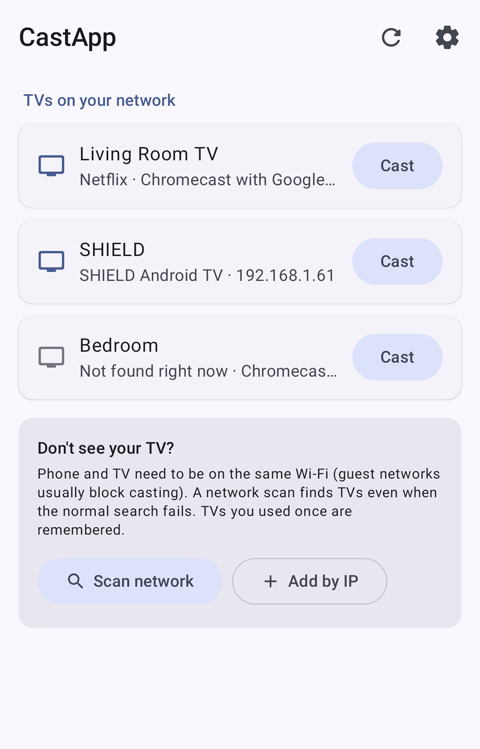
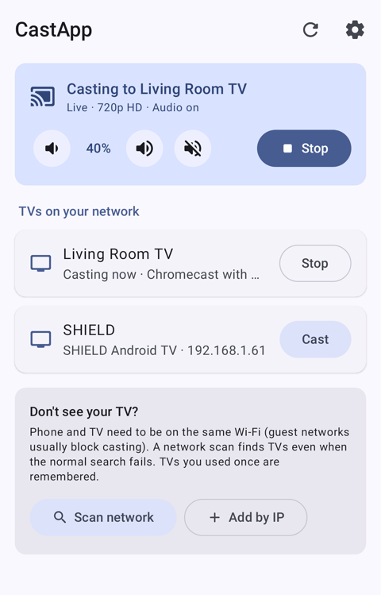
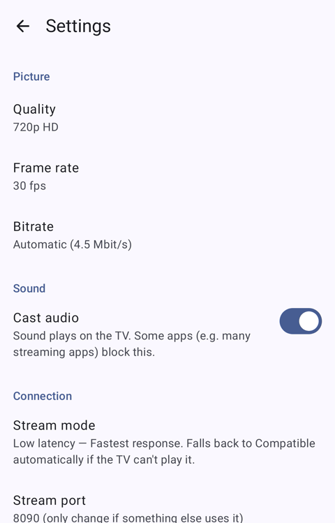

# CastApp

Mirror your Android phone's screen, or a single app, to a **Chromecast**, **NVIDIA Shield**, **Google TV** or any other TV with Google Cast built in.

No ads, no tracking, no account. CastApp doesn't need Google Play Services or the phone's built-in Cast menu. It talks to the TV directly over your Wi-Fi.

<p>
  
  
  
</p>

## Why it finds TVs the built-in Cast menu misses

The system Cast menu relies on a single discovery method (multicast DNS). That method often breaks with mesh Wi-Fi, some routers, or a phone that is aggressively saving power. CastApp combines four methods:

1. **Android's own discovery** (NsdManager)
2. **Its own mDNS browser.** Devices answer it directly by unicast, so this works even when multicast replies get dropped.
3. **Network scan.** It checks every address on your Wi-Fi for a Cast device on port 8009 and asks each one for its name. If nothing turns up within 4 seconds, the scan starts automatically.
4. **Add by IP.** You type the TV's address yourself.

Any TV you've cast to once is **remembered** and reached by its IP address, so it stays one tap away even when discovery fails later.

## Features

- **Mirror the entire screen** with one tap on **Cast**.
- **Cast a single app.**
  - Android 14 and newer: Android's own picker lets you choose one app, and only that app is shown on the TV.
  - Android 13 and older: pick an app in CastApp. The screen is mirrored and that app opens right away.
- **Sound on the TV** (Android 10+): captures what other apps play. The microphone is never used.
- **Low latency.** The live stream reaches the TV with well under a second of buffering. If a TV can't play that format, CastApp switches to a compatible HLS stream automatically.
- **Quick access:**
  - **Quick Settings tile "Cast screen"**: tap to mirror to the last TV, tap again to stop. Long-press opens the app.
  - **Launcher shortcuts**: long-press the app icon for "Mirror screen to *your TV*".
  - **Notification** with Volume −, Volume + and Stop while casting.
- **TV volume and mute** from the app or the notification.
- **Simple settings:** quality (540p / 720p / 1080p), 30 or 60 fps, bitrate, audio on/off, stream mode and port.

## Install

**Download a ready-made APK:** open the repository's **Actions** tab, select the latest **Build APK** run and download the **CastApp** artifact. It's a zip containing `CastApp.apk`. If you push a tag such as `v1.0.0`, the APK is also attached to a GitHub Release.

To install, open the APK on your phone and allow "Install unknown apps" for your browser or file manager when Android asks.

**Build it yourself:**

```bash
./gradlew assembleRelease
# -> app/build/outputs/apk/release/app-release.apk
```

You need JDK 17+ and the Android SDK with platform `android-37.1`. Opening the project in Android Studio sets that up for you.

## How to use

1. Connect your phone and the TV to the **same Wi-Fi**. Guest networks usually block device-to-device traffic.
2. Open CastApp. Your TVs appear within a few seconds.
3. Tap **Cast** next to a TV to mirror your screen. You can also tap the TV's name and choose **Cast a single app**.
4. Confirm Android's "Start casting?" dialog.
5. Stop casting from the app, the notification, the Quick Settings tile, or by pressing Back/Home on the TV remote.

To add the tile, pull down Quick Settings, tap the pencil (edit) icon and drag **Cast screen** into your tiles.

## How it works

```
 Phone                                                      TV (Chromecast / Shield)
 ─────                                                      ────────────────────────
 MediaProjection ─► H.264 encoder ─┐
                                    ├─► fragmented MP4 ─► HTTP server :8090 ◄── fetches the stream
 AudioPlaybackCapture ─► AAC ──────┘                                              ▲
                                                                                  │
 Cast v2 protocol (TLS :8009) ── LAUNCH Default Media Receiver, LOAD stream URL ──┘
```

- **Cast protocol.** CastApp speaks Cast v2 itself (`cast/CastClient.kt`): length-prefixed protobuf messages over TLS on port 8009. It starts Google's **Default Media Receiver** on the TV, which every Cast device has, and asks it to play a URL served by the phone.
- **Stream.** The screen is encoded to H.264 with the phone's hardware encoder and sent as a live fragmented-MP4 stream (`stream/`). Each fragment holds one frame, which keeps latency low. If the TV falls behind, buffered frames are dropped so the delay doesn't keep growing. The **Compatible** mode serves the same data as 1-second HLS segments.
- **Picture shape.** The stream is always 16:9, like a TV. A portrait phone shows up centred with bars, and rotating the phone never interrupts the stream.
- **Privacy.** Stream URLs contain a random token, so other devices on your network can't watch your screen. The server only runs while you're casting.

## Limitations

- **Protected video shows black.** Netflix, Disney+, Prime Video and similar apps block screen capture, and so do banking apps. That's an Android rule. Use those apps' own Cast button instead.
- **Some apps block audio capture.** Many streaming apps opt out of audio capture. Their picture is still cast.
- **Delay.** Low latency mode is fine for presentations, photos, browsing and video. Fast games will still feel a bit of lag. Compatible (HLS) mode adds a few seconds of delay.
- **Phone sound.** The phone keeps playing sound while casting audio. You can turn the phone's volume down. On many phones that doesn't change the sound on the TV, but on some it does.
- **Untested on real hardware.** The code is built and unit-tested, but these parts couldn't be checked without a phone and TV:
  - the Cast handshake with real devices
  - the MediaProjection permission flow on each Android version
  - how each phone's hardware encoder behaves

## Troubleshooting

| Problem | Try this |
|---|---|
| TV not listed | Tap **Scan network**. Make sure it isn't a guest network. Or add it with **Add by IP**: the address is on the TV under *Settings → Network*. |
| "Can't reach … Is it on the same Wi-Fi?" | Your phone or TV moved to another network or band. Some routers isolate 2.4 GHz from 5 GHz, or wired from wireless. |
| TV shows a spinner, then nothing | Settings → **Stream mode → Compatible**. Also check that a VPN or firewall app on the phone isn't blocking incoming connections on port 8090. |
| Choppy picture | Lower the quality to 540p or the bitrate to 2–4 Mbit/s, or move closer to the router. |
| Port conflict | Change **Stream port** in settings. |

## Project layout

```
app/src/main/java/io/github/patschgoo/castapp/
├── cast/          Cast v2 protocol (protobuf framing, TLS client)
├── discovery/     NSD, raw mDNS, network scan, remembered devices
├── stream/        fragmented MP4 muxer, live HTTP server, HLS segmenter
├── capture/       screen (H.264) and audio (AAC) encoders
├── service/       foreground service and casting session logic
├── tile/          Quick Settings tile
├── ui/            Jetpack Compose screens
├── MainActivity.kt, ProjectionActivity.kt, Shortcuts.kt
```

## Signing key

`app/castapp.keystore` (password `castapp`) is committed on purpose. Every build, on your PC or in CI, is signed with the same key, so a new APK installs over the old one. This is fine for personal use. If you ever publish the app, replace the key with your own private one.

## License

No license has been chosen yet. Add one (for example MIT or GPL-3.0) if you want others to be able to reuse the code.
