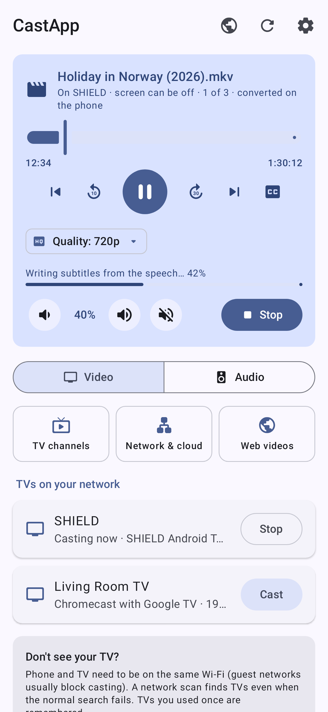
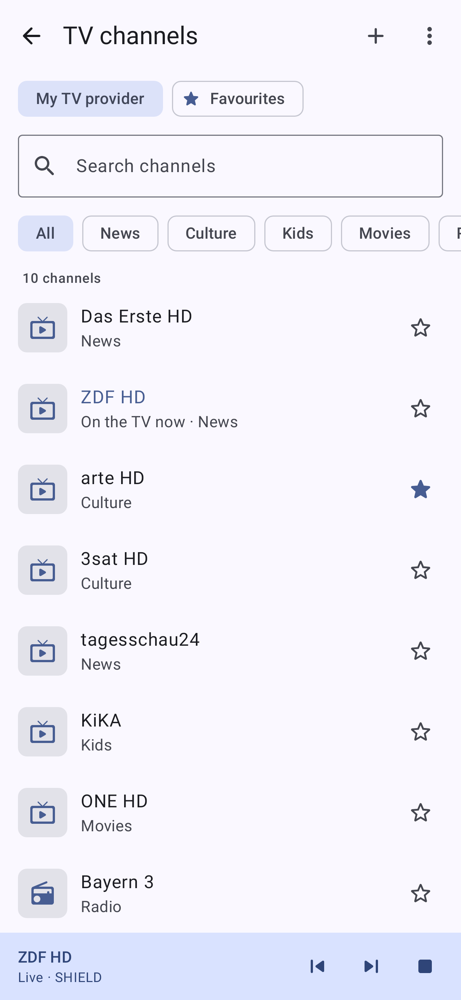
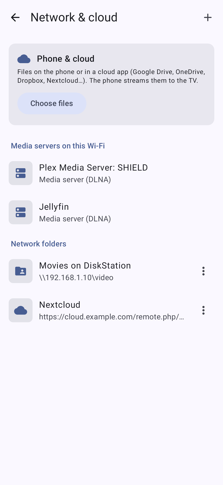
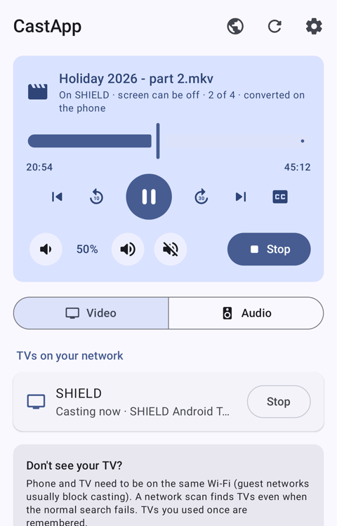

# CastApp

Android app that casts to a **Chromecast**, **NVIDIA Shield**, **Google TV**, **Google/Nest speakers** and **DLNA smart TVs** (Samsung, LG, Sony…). It can:

- mirror your screen or a single app, in a quality you can change at any moment
- play the phone's sound
- play videos, music and photos from the phone, a NAS, a PC's shared folder, a media server (Plex, Jellyfin…) or a cloud folder
- play TV channels and radio from IPTV / M3U channel lists
- play videos it finds on websites
- write subtitles for videos that have none, on the phone and offline

No ads, no tracking, no account. It doesn't need Google Play Services or the phone's built-in Cast menu; it talks to your devices directly over your Wi-Fi.

<p>
  
  
  
</p>
<p>
  
  
</p>

## Why it finds devices the built-in Cast menu misses

The system Cast menu relies on a single discovery method (multicast DNS). That method often breaks with mesh Wi-Fi, some routers, or a phone that is aggressively saving power. CastApp combines five methods:

1. **Android's own discovery** (NsdManager)
2. **Its own mDNS browser.** Devices answer it directly by unicast, so this works even when multicast replies get dropped.
3. **DLNA/UPnP search (SSDP).** This finds smart TVs without Chromecast.
4. **Network scan.** It checks every address on your Wi-Fi for a Cast device and asks each one for its name. If nothing turns up within 4 seconds, the scan starts automatically.
5. **Add by IP.** You type the address yourself.

Any device you've cast to once is **remembered**. If its IP address changes, CastApp finds it again.

## Features

**Video mode** (TVs):

- **Mirror the entire screen** with one tap on **Cast**.
- **Cast a single app.**
  - Android 14 and newer: Android's own picker; only that app is shown on the TV.
  - Android 13 and older: the screen is mirrored and the app you pick opens.
- **Videos, music and photos from the phone**, with the phone's screen off.
  - Pick several files to get a **play list**.
  - **Photos** become a slideshow, shrunk to TV size; HEIC and huge photos work too.
  - **Subtitles**: pick an `.srt`/`.vtt` file with the same name as the video (or pick just one video and one subtitle file). They can be switched on and off.
  - Also available from any gallery or file app via **Share → Cast to TV**.
- **TV channels (IPTV)**, **network shares, NAS, media servers and cloud folders**: see the sections below.
- **Change the picture quality at any moment** with the **Quality** button on the casting card (see below).
- **Subtitles written by the phone** for videos and music that have none (see below).
- **Videos from websites**: the built-in browser (🌐 at the top) spots the videos a page plays and sends them to the TV. The TV then plays them by itself, so you can leave the app or lock the phone. A link shared from Firefox, Chrome and so on (**Share → Cast to TV**) opens in this browser.
- **Converts videos the TV can't play** (e.g. HEVC or MKV on an older Chromecast). The phone re-encodes them to H.264/AAC on the fly. This happens automatically; you can choose Automatic, Always or Never in Settings.
- **Dark screen** (Android 14+, single-app casting): the phone goes black at minimum brightness while the app keeps playing on the TV. Tap once for controls, double-tap to wake.

**Audio mode** (switch at the top):

- Lists **speakers and speaker groups** as well as TVs.
- **Cast the phone's sound** (Android 10+): whatever plays on the phone plays on the speaker. The microphone is never used.
- **Play music files** on a speaker.

**Picture and sound:**

- **Low delay**, under a second with Google's standard player.
- An optional own **low-latency TV player** gets it to about 0.3 s (see below).
- **Automatic quality**: when the Wi-Fi can't keep up, the bitrate drops; when the connection is good again, it rises.
- **Picture shape**:
  - *Fit*: black bars where the shapes differ.
  - *Fill the TV*: zooms in and cuts off the edges.
  - *Turn apps sideways*: rotates the phone's apps to landscape so they fill the TV.
- **Sound sync**: shift the sound ±500 ms. Changes apply instantly while casting.
- **Reconnects by itself** if the Wi-Fi drops or the TV restarts. It keeps trying for 2 minutes, and a file continues where it stopped.

**Controls and quick access:**

- TV volume and mute from the app, the notification and, when casting a file, the phone's volume buttons.
- Media controls on the lock screen when casting files.
- **Quick Settings tile "Cast screen"**: tap to mirror to the last TV, tap again to stop. Long-press opens the app.
- **Launcher shortcuts**: long-press the app icon for "Mirror screen to *your TV*".

**Looks:** light and dark mode that follow the system, with wallpaper colors (Material You) on Android 12+. You can force Light or Dark in Settings.

## Install

**Download a ready-made APK:** open the repository's **Actions** tab, select the latest **Build APK** run and download the **CastApp** artifact. It's a zip containing `CastApp.apk`. If you push a tag such as `v3.0.0`, the APK is also attached to a GitHub Release.

The APK is about 10 MB, most of it the offline speech recognition. To install, open the APK on your phone and allow "Install unknown apps" for your browser or file manager when Android asks.

**Build it yourself:**

```bash
./gradlew assembleRelease
# -> app/build/outputs/apk/release/app-release.apk
```

You need JDK 17+ and the Android SDK with platform `android-37.1`. Opening the project in Android Studio sets that up for you.

## How to use

1. Connect your phone and the TV or speaker to the **same Wi-Fi**. Guest networks usually block device-to-device traffic.
2. Open CastApp and choose **Video** or **Audio** at the top.
3. Tap **Cast** next to a device:
   - in Video mode, this mirrors the screen;
   - in Audio mode, it casts the phone's sound.

   Tap the device's name for more options: a single app, files, web videos, or sound only.

   Below the Video/Audio switch, **TV channels**, **Network & cloud** and **Web videos** open what you'd like to play; you pick the TV when you start it. While a file or channel is already playing, anything new goes straight to that TV.
4. Confirm Android's "Start casting?" dialog. File and web-video casting doesn't need this dialog.
5. Stop from the app, the notification, the Quick Settings tile, or the TV remote.

To add the tile, pull down Quick Settings, tap the pencil (edit) icon and drag **Cast screen** into your tiles.

## Casting with the phone's screen off

| What you cast | Screen off / locked? |
|---|---|
| **Files, photos, web videos** | **Yes.** The TV fetches them itself; lock the phone and pocket it. |
| **The phone's sound** (Audio mode) | **Yes**, on most phones: music apps keep playing in the background. |
| **A single app** (Android 14+) | **Use Dark screen.** The display stays technically on but black, so the app keeps playing. The TV doesn't see the dark overlay. |
| **The entire screen** | **No.** If the screen is off there is nothing to mirror, and Android pauses most apps. |

**Can I cast from Firefox and leave it playing?** Not by mirroring Firefox: as soon as you leave it or lock the phone, the video pauses. Instead, share the page from Firefox to **Cast to TV** (or open it in CastApp's browser) and cast the video it finds. The TV then plays it on its own, like YouTube's Cast button.

## Change the quality at any moment

While casting, tap **Quality** on the casting card:

| What you cast | Choices | What happens |
|---|---|---|
| **Screen or app** | 480p, 540p, 720p, 1080p, 1440p, 4K | The phone switches its encoder on the fly and the TV reloads (about a second). The choice is remembered. 1440p and 4K only work if the phone's encoder can do them; otherwise the cast stops with a message. |
| **Videos** (phone, network, web) | Original, 1080p, 720p, 480p | *Original* plays the file as it is. A smaller size is converted on the phone, which helps on weak Wi-Fi or with a TV that stutters. Playback continues where it was, and the choice also applies to the next videos in the list. |
| **HLS streams** (most web videos and TV channels) | Auto, or each quality the stream offers | *Auto* lets the TV adapt to the Wi-Fi. Picking a level makes the TV play exactly that one. |

## TV channels (IPTV / M3U)

An **M3U** (or M3U8) file is a channel list: a name, an optional logo and group, and a stream address for every TV channel or radio station. IPTV providers give you one as a link; TVHeadend servers, some TV providers and public lists of free channels publish one as well. (Lists with `rtsp://` addresses, as some routers and SAT>IP boxes make, can't be played on Cast devices.)

1. On the main screen, tap **TV channels**, then **+**.
2. Add the list as a **link**, a **file** on the phone, or a provider **log-in** (server, user name and password of an "Xtream Codes" provider).
3. Pick a channel. The list you see (the group or search you're in) becomes the play list, so **Previous / Next** on the phone, in the notification or on the lock screen switch channels.

Groups, search and ★ favourites help with long lists. Channels play on the TV by themselves, so the phone can be locked. Radio stations work on speakers too. Channels that need a particular User-Agent or Referer (`#EXTVLCOPT` lines or Kodi-style `|User-Agent=…`) get it. Channels whose address doesn't say what they are are checked first; plain MPEG-TS channels, which Chromecasts can't play directly, are converted on the phone if possible (Convert setting). Only use channel lists you are allowed to watch.

## Network shares, NAS, media servers and cloud

Tap **Network & cloud** on the main screen.

- **Media servers on this Wi-Fi** are found automatically: Plex, Jellyfin, Emby, Synology/QNAP media servers, Kodi, Windows Media sharing and other DLNA/UPnP servers. Browse their folders and play.
  - *Plex* (also Plex Media Server on a Shield with your hard drives): turn on **Settings → DLNA → Enable the DLNA server** in Plex.
  - *Jellyfin* 10.9 and newer: install the **DLNA** plugin.
- **Network folders** you add with **+**:
  - **Windows / Samba share** (SMB 2/3): most NAS boxes, a router's USB disk, a PC's shared folder, a Shield's shared drives. Enter the server name or IP, the share name and, unless it allows guests, user name and password. `\\nas\Media` also works as the address.
  - **WebDAV**: Nextcloud and ownCloud (`https://your-server/remote.php/dav/files/USER/`, an app password is best), Synology/QNAP WebDAV, many other NAS and cloud services. You can allow a self-signed certificate for your own NAS.

  CastApp checks the folder before saving it. Passwords are stored encrypted (Android Keystore) on the phone only.
- **Phone & cloud** opens Android's file picker, which also shows installed cloud apps (Google Drive, OneDrive, Dropbox, Nextcloud…).

Tapping a file plays the whole folder as a play list, starting with that file; **Play all** starts at the top. Subtitles with the same name as a video (`.srt`, `.vtt`) are picked up automatically. Files on shares and password-protected servers are streamed by the phone (with seeking); media servers are played by the TV directly.

## Subtitles written by the phone

For a video or music file without subtitles, CastApp can write them with **offline speech recognition** ([Vosk](https://alphacephei.com/vosk/)). Nothing is uploaded.

1. **Settings → Subtitles → Spoken language**: pick the language spoken in your videos. It is downloaded once (30–50 MB): English, Deutsch, Français, Español, Italiano, Nederlands, Português, Polski, Русский, Türkçe, 日本語, 中文, हिन्दी.
2. While a video plays, tap **Write subtitles** on the casting card. Or turn on **Write subtitles automatically**.

The TV shows the first subtitles once a few minutes ahead of you are done, and the complete ones when the phone has finished (the TV reloads briefly at the same spot each time). Finished subtitles are kept, so the next time they are there right away. They are in the spoken language; there is no translation. Clear speech works well; music, noise, strong accents and people talking at once lead to mistakes.

For **live TV, streams and screen mirroring** there's no file to read ahead, so use Android's **Live Caption** (Android 10+, on Pixel, Samsung and many other phones): it captions anything playing on the phone, and when you mirror the screen the captions show on the TV as well. The **Live Caption** button on the casting card and in Settings opens the caption settings.

## DLNA TVs (Samsung, LG, Sony, …)

TVs without Chromecast appear with a **DLNA** label.

- Files, photos, music and web videos work well.
- Samsung TVs also show `.srt` subtitles.
- Screen mirroring to a DLNA TV is **experimental**. It works on many TVs, but with a few seconds of delay, because these TVs buffer heavily. A Samsung TV's own *Smart View* may be faster for mirroring.

A TV that supports both Chromecast and DLNA is shown once, as a Chromecast.

## Low-latency TV player (optional, advanced)

Google's standard player buffers about a second. CastApp includes its own TV player (`receiver/index.html`) that keeps the picture about 0.3 s behind the phone. Google only lets registered players run on Cast devices, so it needs a one-time setup:

1. **Host the player.**
   1. In your GitHub repository, go to **Settings → Pages** and set the source to **GitHub Actions**.
   2. Under **Actions**, run **Publish TV player**.

   It is published at `https://<your-user>.github.io/<repo>/`. GitHub Pages on a private repository needs a paid GitHub plan; any other HTTPS web host works too.
2. **Register it** at the [Google Cast SDK Developer Console](https://cast.google.com/publish) (one-time US$5 fee):
   1. Add a **Custom Receiver** with the address from step 1.
   2. Either publish it, or register your Chromecast/Shield's serial number as a test device.
3. **Use it.** In CastApp, go to **Settings → Low-latency TV player** and enter the 8-character **App ID**.

If the player doesn't start, CastApp falls back to Google's standard player automatically. You can also try the player in a desktop browser: `receiver/index.html?test=<stream URL>&codecs=avc1.64001F,mp4a.40.2`.

## How it works

```
 Phone                                                      TV / speaker
 ─────                                                      ────────────
 MediaProjection ─► H.264 encoder ─┐                         Chromecast / Shield / Google TV:
                                    ├─► stream server :8090 ◄─ fetches live MP4 / HLS / AAC
 AudioPlaybackCapture ─► AAC ──────┘   (token in every URL)    DLNA TV: fetches live MPEG-TS
 Files / photos / subtitles ──────────►  byte-range file server ◄─ seeks
 SMB shares (smbj) / WebDAV ──────────►  (same server, with log-in)
 Web videos, IPTV ──► (direct, or via the phone's proxy for cookies/CORS/log-in)
 DLNA media servers ──► played by the TV directly
 Unplayable video ─► decode ─► GL scale ─► H.264/AAC ─► live MP4
 Sound of a file ─► decode ─► 16 kHz ─► Vosk ─► timed WebVTT/SRT

 Control: Cast v2 (TLS :8009) to the Default Media Receiver or our own player,
          UPnP AVTransport (SOAP) for DLNA TVs
```

- **Cast protocol.** CastApp speaks Cast v2 itself (`cast/`): protobuf messages over TLS on port 8009.
- **Stream.** The screen is encoded with the phone's hardware encoder and sent as live fragmented MP4, one frame per fragment. Other formats are used when a device needs them:
  - HLS for compatibility;
  - plain AAC for speakers;
  - MPEG-TS for DLNA TVs.

  If the Wi-Fi falls behind, the bitrate is lowered, and if needed buffered frames are dropped so the delay stays short.
- **Files.** The phone serves files with byte-range support, so the TV can seek. Photos are shrunk on the phone. SRT subtitles are converted to WebVTT, including old Windows-1252 files with umlauts.
- **Web videos.** The browser watches the page's network traffic and `<video>` elements. If the TV can't fetch a video directly, the phone relays it: it adds the site's cookies and referrer and the CORS headers Cast devices need, and rewrites HLS playlists so every segment also goes through the phone.
- **Converting.** `MediaExtractor` → hardware decoder → OpenGL scaling (max 1920×1080) → H.264 encoder. Audio is decoded, mixed down to stereo and re-encoded to AAC. The TV pulls the result as a stream, and seeking restarts the conversion at the new position.
- **Network sources.** SMB 2/3 through [smbj](https://github.com/hierynomus/smbj) (with BouncyCastle for the NTLM log-in, which Android's crypto lacks); WebDAV through `PROPFIND`; media servers through UPnP ContentDirectory `Browse`. Files are read from any position, so seeking works.
- **IPTV.** The M3U reader understands `#EXTINF` attributes (logo, group), `#EXTGRP`, `#EXTVLCOPT` and Kodi-style header options. HLS master playlists are read so a fixed quality can be chosen; the proxy then hands the TV a playlist with only that level.
- **Subtitles.** The sound track is decoded with `MediaCodec`, mixed to mono and resampled to 16 kHz for Vosk; the recognised words with their times are grouped into subtitles of up to two lines of 42 characters, split at pauses. A converted video starts its clock at 0, so subtitles are shifted to match.
- **Privacy.** Every URL contains a random token, so other devices on your network can't watch. The servers only run while you're casting.

## Limitations

- **Protected video shows black.** Netflix, Disney+, Prime Video and banking apps block screen capture (an Android rule). Their websites use DRM, so the browser can't cast them either. Use their own Cast button.
- **YouTube** uses streams that only its own apps can play. Use YouTube's Cast button, or the YouTube app on the Shield.
- **Some apps block audio capture** (often streaming or music apps). For music, Spotify Connect and similar built-in features work better.
- **Converting** uses battery and only works while the phone is on Wi-Fi. Seeking in a converted video takes a moment. The same goes for choosing a smaller quality for a file.
- **Writing subtitles** uses the processor and battery while it runs. It needs a file (not live TV or an HLS stream).
- **IPTV**: no programme guide (EPG) yet, and DRM-protected channels can't be played.
- **Network folders**: Kerberos-only Windows domains aren't supported (user name and password log-in is).
- **Untested on real hardware.** Everything is built and unit-tested. The streams were also checked in a real browser player:
  - live MP4 in Chromium;
  - the low-latency player at about 0.35 s of buffer;
  - AAC and MPEG-TS in ffmpeg;
  - file seeking in Chromium;
  - SMB browsing, reading and log-in against a real Samba server.

  These couldn't be checked without real phones and TVs:
  - the Cast and DLNA handshakes with real devices;
  - screen capture and the permission flow on each Android version;
  - hardware encoders and decoders (also used for converting);
  - Dark screen and Turn apps sideways;
  - lock-screen controls;
  - speech recognition on a phone, real IPTV providers, and Plex/Jellyfin servers.

## Troubleshooting

| Problem | Try this |
|---|---|
| TV not listed | Tap **Scan network**. Make sure it isn't a guest network. Or add it with **Add by IP**: the address is on the TV under *Settings → Network*. |
| Speaker not listed | Switch to **Audio** at the top. |
| "Can't reach … Is it on the same Wi-Fi?" | Your phone or TV moved to another network or band. Some routers isolate 2.4 GHz from 5 GHz, or wired from wireless. |
| TV shows a spinner, then nothing | Settings → **Stream mode → Compatible**. Also check that a VPN or firewall app on the phone isn't blocking incoming connections on port 8090. |
| A file won't play | Settings → **Convert videos the TV can't play → Always**. |
| A website's video won't play | Start the video on the page first, then tap **Cast video**. If several are listed, try the "Stream (HLS)" one. |
| Choppy picture | Keep **Automatic quality** on, lower the quality to 540p, or move closer to the router. |
| Lips and sound don't match | Settings → **Sound sync**. |
| Port conflict | Change **Stream port** in settings. |
| Plex / Jellyfin not under "Media servers" | Turn on DLNA in Plex (Settings → DLNA) or install Jellyfin's DLNA plugin. Phone and server must be on the same network. Or add the server's shared folder as a **network folder**. |
| A network folder says "Wrong user name or password" / "Access denied" | Use the account of the NAS or PC (for a Microsoft account on Windows, the e-mail address and its password). Check the share name in the NAS's settings. |
| A TV channel doesn't play | Many free lists contain dead channels; CastApp skips to the next one. For MPEG-TS channels on a Chromecast keep **Convert videos** on Automatic. |
| Subtitles have many mistakes | Check that the spoken language is right in Settings. Recognition works best with clear speech. |

## Project layout

```
app/src/main/java/io/github/patschgoo/castapp/
├── cast/          Cast v2 protocol (protobuf framing, TLS client)
├── dlna/          UPnP/DLNA discovery (SSDP), SOAP control, media-server browsing
├── discovery/     NSD, raw mDNS, network scan, remembered devices
├── render/        "play this URL" for Cast and DLNA devices
├── stream/        MP4/TS/ADTS muxers, stream & media servers, HLS, web proxy, subtitles
├── capture/       screen and audio encoders, OpenGL scaler, video converter
├── service/       foreground service, screen/sound and media sessions, overlays
├── browser/       video detection for the built-in browser
├── iptv/          M3U channel lists, favourites
├── network/       SMB shares, WebDAV, saved network folders, encrypted passwords
├── subtitles/     speech recognition (Vosk), language downloads, subtitle timing
├── tile/          Quick Settings tile
├── ui/            Jetpack Compose screens
receiver/          optional low-latency TV player (web app for Cast devices)
```

## Signing key

`app/castapp.keystore` (password `castapp`) is committed on purpose. Every build, on your PC or in CI, is signed with the same key, so a new APK installs over the old one. This is fine for personal use. If you ever publish the app, replace the key with your own private one.

## License

No license has been chosen yet. Add one (for example MIT or GPL-3.0) if you want others to be able to reuse the code.
